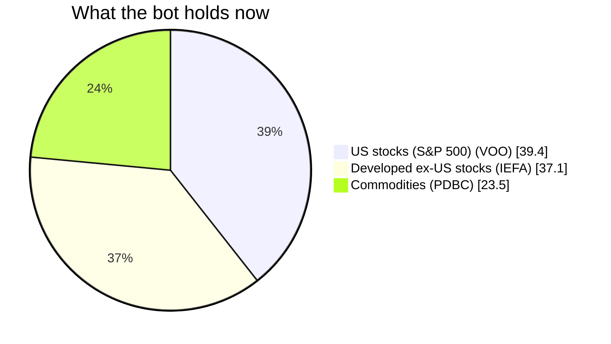

# Trading Bot — Dashboard

> [!info] 🤖 Bot is ACTIVE — last run 2026-11-12 at 15:43: **HOLD**
> No rebalance due (signal of 2026-10-30 already acted on).
> Next scheduled rebalance: **2026-12-01** (first trading day of the month). Every other weekday it checks prices and risk, and writes a journal.

**Mode:** `paper` · **Region:** `us` · **Strategy:** `CORE` · **Data through:** 2026-11-12

## Account

| | |
|---|---|
| Equity | 9,949 |
| Started with | 10,000 |
| Return since start | -0.5% |
| Peak | 9,949 |
| Drawdown | +0.0% (halt at -25%) |

## Holdings now

| Asset | Weight | Instrument |
|---|---|---|
| US stocks (S&P 500) | 39.4% | VOO (US-listed) |
| Developed ex-US stocks | 37.1% | IEFA (US-listed) |
| Commodities | 23.5% | PDBC (US-listed) |

## Recent runs

| Date | Status | Equity |
|---|---|---|
| [[2026-11-12]] | HOLD | 9,949 |
| [[2026-11-12]] | HOLD | 9,990 |
| [[2026-11-12]] | TRADED | 9,990 |

## Notes

- [[06 - One-Month Trial]] — **live paper trial vs the S&P 500**
- [[07 - Trade Log]] — every buy and sell
- [[08 - Last 12 Months Replay]] — every trade it would have made in the past year
- [[01 - How the Bot Works]] — the rules, in plain words
- [[02 - Risk Limits]] — **edit this to change the bot's settings**
- [[03 - Backtest Report]] — 1997–2026 evidence incl. every crash
- [[04 - How to Run It]] — commands, schedule, going live
- [[05 - Fixes to the Old Engine]] — what was broken and what changed
