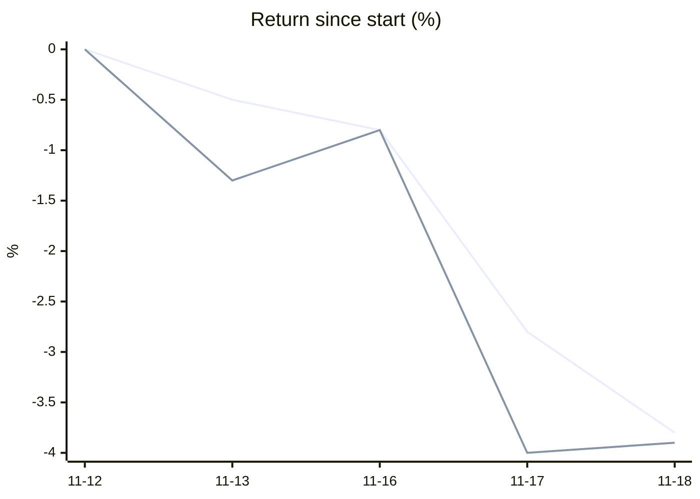

# 06 - One-Month Paper Trial

**2026-11-12 → 2026-12-12** · account `alpaca-paper` starting at 100,000 · settings: worst month 15% (vol cap 22.3%), max 80% per ETF, region `us`

> [!success] Day 5: bot -3.8% vs S&P 500 -3.9%
> Equity 96,244 · ahead by 0.2 points (prices through 2026-11-18)

## Daily log

| Run | Prices through | Equity | Bot | S&P 500 | Difference |
|---|---|---|---|---|---|
| [[2026-11-12]] | 2026-11-12 | 99,989 | -0.0% | +0.0% | -0.0% |
| [[2026-11-13]] | 2026-11-13 | 99,471 | -0.5% | -1.3% | +0.7% |
| [[2026-11-16]] | 2026-11-13 | 99,231 | -0.8% | -0.8% | +0.1% |
| [[2026-11-17]] | 2026-11-17 | 97,159 | -2.8% | -4.0% | +1.2% |
| [[2026-11-18]] | 2026-11-18 | 96,244 | -3.8% | -3.9% | +0.2% |

*Lines: first = **Bot** · second = **S&P 500***

## How to read this

- One month is **noise**, not evidence. In the 30-year backtest the bot trailed the S&P 500 in about half of all months and still finished with similar returns and a third of the crash damage.
- The bot rebalances once a month, on the first trading day after the month-end. Expect one rebalance inside this trial.
- What to check: that it ran every weekday, followed its rules, and that the journal explains every trade. That is what this month can prove.

Related: [[00 - Bot Dashboard]] · [[03 - Backtest Report]] · [[02 - Risk Limits]]
