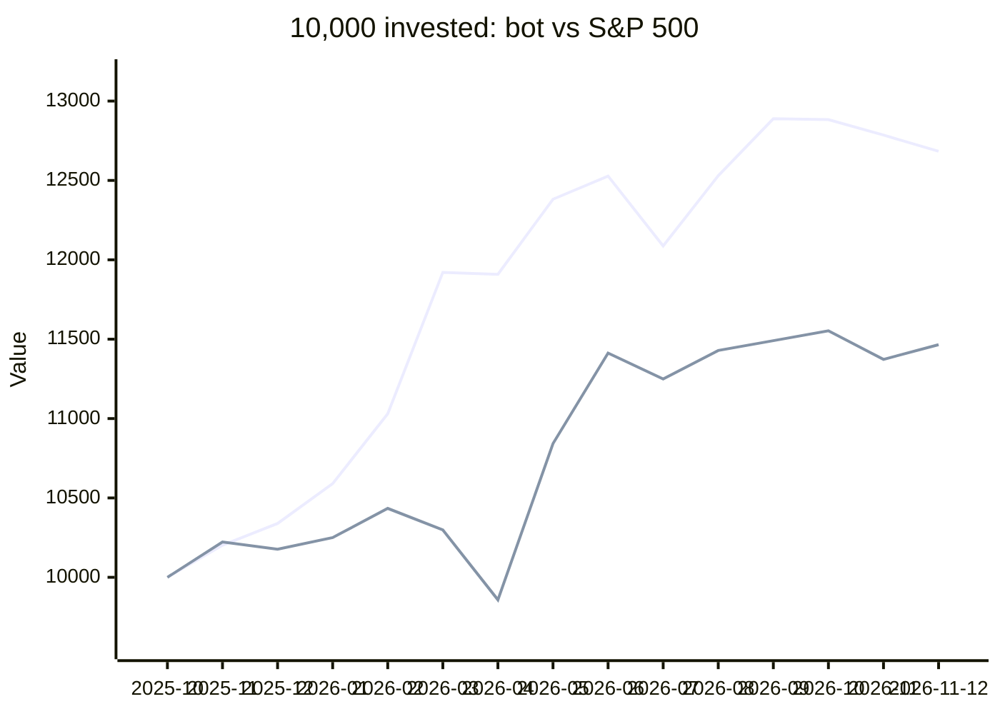

# 08 - Last 12 Months: Every Trade the Bot Would Have Made

> [!note] This is a replay, not live trading
> The current rules run on real market prices from the past year, starting with 10,000 on 2025-10-01. Costs included. The live paper account is in [[06 - One-Month Trial]] and [[07 - Trade Log]].

> [!success] Result: bot +26.8% (worst fall -5.9%) vs S&P 500 +14.7% (worst fall -8.9%)

*Lines: first = **Bot** · second = **S&P 500***

## Month by month

### 2025-10-01 — rebalance

| Action | ETF | Change | New weight |
|---|---|---|---|
| 🟢 BUY | **GLDM** (Gold) | +27.5 pts | 27.5% |
| 🟢 BUY | **IEFA** (Developed ex-US stocks) | +31.1 pts | 31.1% |
| 🟢 BUY | **VOO** (US stocks (S&P 500)) | +41.4 pts | 41.4% |

Holdings: VOO 41%, IEFA 31%, GLDM 27%
Until the next rebalance: **bot +2.0%** vs S&P 500 +2.2%

### 2025-11-03 — rebalance

| Action | ETF | Change | New weight |
|---|---|---|---|
| 🔴 SELL | **GLDM** (Gold) | -2.2 pts | 25.3% |
| 🟢 BUY | **IEFA** (Developed ex-US stocks) | +6.1 pts | 37.2% |
| 🔴 SELL | **VOO** (US stocks (S&P 500)) | -3.8 pts | 37.6% |

Holdings: VOO 38%, IEFA 37%, GLDM 25%
Until the next rebalance: **bot +8.1%** vs S&P 500 +2.1%

### 2026-02-02 — rebalance

| Action | ETF | Change | New weight |
|---|---|---|---|
| 🟢 BUY | **PDBC** (Commodities) | +35.7 pts | 35.7% |
| 🟢 BUY | **GLDM** (Gold) | +1.7 pts | 26.9% |
| 🔴 SELL | **VOO** (US stocks (S&P 500)) | -37.6 pts | 0.0% |

Holdings: IEFA 37%, PDBC 36%, GLDM 27%
Until the next rebalance: **bot +8.1%** vs S&P 500 -1.3%

### 2026-03-02 — rebalance

| Action | ETF | Change | New weight |
|---|---|---|---|
| 🔴 SELL | **PDBC** (Commodities) | -1.4 pts | 34.3% |
| 🔴 SELL | **GLDM** (Gold) | -11.5 pts | 15.4% |
| 🟢 BUY | **IEFA** (Developed ex-US stocks) | +12.9 pts | 50.2% |

Holdings: IEFA 50%, PDBC 34%, GLDM 15%
Until the next rebalance: **bot +3.9%** vs S&P 500 +5.3%

### 2026-05-01 — rebalance

| Action | ETF | Change | New weight |
|---|---|---|---|
| 🟢 BUY | **PDBC** (Commodities) | +3.8 pts | 38.2% |
| 🔴 SELL | **GLDM** (Gold) | -3.0 pts | 12.4% |
| 🔴 SELL | **IEFA** (Developed ex-US stocks) | -50.2 pts | 0.0% |
| 🟢 BUY | **VOO** (US stocks (S&P 500)) | +49.4 pts | 49.4% |

Holdings: VOO 49%, PDBC 38%, GLDM 12%
Until the next rebalance: **bot +1.2%** vs S&P 500 +5.3%

### 2026-06-01 — rebalance

| Action | ETF | Change | New weight |
|---|---|---|---|
| 🔴 SELL | **PDBC** (Commodities) | -13.8 pts | 24.4% |
| 🔴 SELL | **GLDM** (Gold) | -12.4 pts | 0.0% |
| 🟢 BUY | **IEFA** (Developed ex-US stocks) | +27.2 pts | 27.2% |
| 🔴 SELL | **VOO** (US stocks (S&P 500)) | -1.0 pts | 48.4% |

Holdings: VOO 48%, IEFA 27%, PDBC 24%
Until the next rebalance: **bot +2.1%** vs S&P 500 -0.3%

### 2026-11-02 — rebalance

| Action | ETF | Change | New weight |
|---|---|---|---|
| 🔴 SELL | **PDBC** (Commodities) | -0.9 pts | 23.4% |
| 🟢 BUY | **IEFA** (Developed ex-US stocks) | +6.5 pts | 33.7% |
| 🔴 SELL | **VOO** (US stocks (S&P 500)) | -5.5 pts | 42.9% |

Holdings: VOO 43%, IEFA 34%, PDBC 23%
Until the next rebalance: **bot -0.8%** vs S&P 500 +0.8%

Back to [[00 - Bot Dashboard]] · Full 30-year evidence: [[03 - Backtest Report]]
