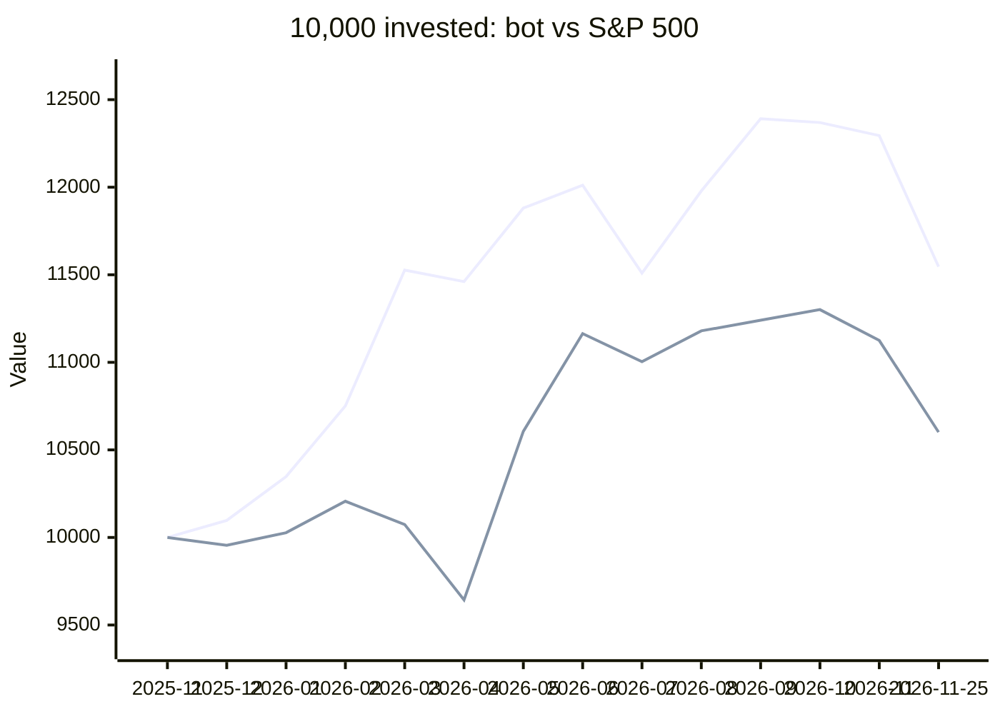

# 08 - Last 12 Months: Every Trade the Bot Would Have Made

> [!note] This is a replay, not live trading
> The current rules run on real market prices from the past year, starting with 10,000 on 2025-11-03. Costs included. The live paper account is in [[06 - One-Month Trial]] and [[07 - Trade Log]].

> [!success] Result: bot +15.5% (worst fall -10.4%) vs S&P 500 +6.0% (worst fall -11.5%)

*Lines: first = **Bot** · second = **S&P 500***

## Month by month

### 2025-11-03 — rebalance

| Action | ETF | Change | New weight |
|---|---|---|---|
| 🟢 BUY | **GLDM** (Gold) | +18.9 pts | 18.9% |
| 🟢 BUY | **IEFA** (Developed ex-US stocks) | +41.0 pts | 41.0% |
| 🟢 BUY | **VOO** (US stocks (S&P 500)) | +40.1 pts | 40.1% |

Holdings: IEFA 41%, VOO 40%, GLDM 19%
Until the next rebalance: **bot +7.5%** vs S&P 500 +2.1%

### 2026-02-02 — rebalance

| Action | ETF | Change | New weight |
|---|---|---|---|
| 🟢 BUY | **SGOV** (Cash (T-bills)) | +2.2 pts | 2.2% |
| 🟢 BUY | **PDBC** (Commodities) | +35.9 pts | 35.9% |
| 🟢 BUY | **GLDM** (Gold) | +1.4 pts | 20.3% |
| 🟢 BUY | **IEFA** (Developed ex-US stocks) | +0.6 pts | 41.7% |
| 🔴 SELL | **VOO** (US stocks (S&P 500)) | -40.1 pts | 0.0% |

Holdings: IEFA 42%, PDBC 36%, GLDM 20%, SGOV 2%
Until the next rebalance: **bot +7.2%** vs S&P 500 -1.3%

### 2026-03-02 — rebalance

| Action | ETF | Change | New weight |
|---|---|---|---|
| 🔴 SELL | **SGOV** (Cash (T-bills)) | -2.2 pts | 0.0% |
| 🔴 SELL | **PDBC** (Commodities) | -3.0 pts | 32.9% |
| 🔴 SELL | **GLDM** (Gold) | -0.8 pts | 19.5% |
| 🟢 BUY | **IEFA** (Developed ex-US stocks) | +5.9 pts | 47.6% |

Holdings: IEFA 48%, PDBC 33%, GLDM 19%
Until the next rebalance: **bot +3.1%** vs S&P 500 +5.3%

### 2026-05-01 — rebalance

| Action | ETF | Change | New weight |
|---|---|---|---|
| 🟢 BUY | **PDBC** (Commodities) | +3.2 pts | 36.1% |
| 🔴 SELL | **GLDM** (Gold) | -4.0 pts | 15.5% |
| 🔴 SELL | **IEFA** (Developed ex-US stocks) | -47.6 pts | 0.0% |
| 🟢 BUY | **VOO** (US stocks (S&P 500)) | +48.4 pts | 48.4% |

Holdings: VOO 48%, PDBC 36%, GLDM 15%
Until the next rebalance: **bot +1.1%** vs S&P 500 +5.3%

### 2026-06-01 — rebalance

| Action | ETF | Change | New weight |
|---|---|---|---|
| 🔴 SELL | **PDBC** (Commodities) | -5.6 pts | 30.5% |
| 🔴 SELL | **GLDM** (Gold) | -15.5 pts | 0.0% |
| 🟢 BUY | **IEFA** (Developed ex-US stocks) | +25.3 pts | 25.3% |
| 🔴 SELL | **VOO** (US stocks (S&P 500)) | -4.2 pts | 44.2% |

Holdings: VOO 44%, PDBC 30%, IEFA 25%
Until the next rebalance: **bot +3.2%** vs S&P 500 +0.7%

### 2026-09-01 — rebalance

| Action | ETF | Change | New weight |
|---|---|---|---|
| 🔴 SELL | **PDBC** (Commodities) | -2.0 pts | 28.5% |
| 🟢 BUY | **IEFA** (Developed ex-US stocks) | +7.2 pts | 32.5% |
| 🔴 SELL | **VOO** (US stocks (S&P 500)) | -5.2 pts | 39.0% |

Holdings: VOO 39%, IEFA 33%, PDBC 28%
Until the next rebalance: **bot -6.8%** vs S&P 500 -5.7%

Back to [[00 - Bot Dashboard]] · Full 30-year evidence: [[03 - Backtest Report]]
