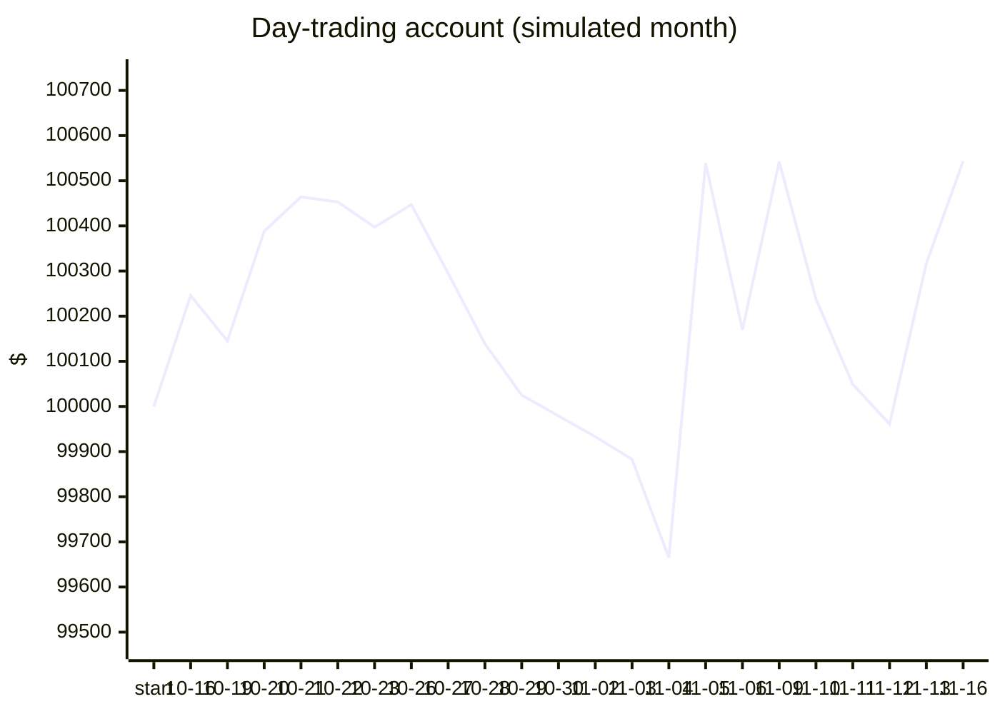

# 13 - Day Trading Month Simulation

> [!info] One month of the live day-trader's rules on real market data (2026-10-16 → 2026-11-16)
> Alpaca market data, IEX feed, 5-minute bars. Same rules and the same $100,000 account as [[12 - Live Day Trading]]. Prices are real; the trades are what the rules would have done. No orders were sent.

## Result

| | |
|---|---|
| Start → end | $100,000.00 → **$100,542.55** (+0.54%) |
| Trading days | 22 (22 with a trade) |
| Trades | 44 — 18 winners, 26 losers |
| Win rate | 41% |
| Expectancy | -0.04 R per trade |
| Profit factor | 1.26 |
| Max drawdown | -0.80% |
| Best day | 2026-11-05 +874.63 |
| Worst day | 2026-11-06 -369.34 |

> [!important] Read it honestly
> 44 trades is a small sample — under 30 is noise, under 100 a hint. One month says little about whether the edge is real.

## Equity curve

## Day by day

| Date | Trades | Day P&L | Equity |
|---|---|---|---|
| 2026-10-16 | 2 | +246.46 | $100,246.46 |
| 2026-10-19 | 2 | -101.82 | $100,144.64 |
| 2026-10-20 | 2 | +242.92 | $100,387.56 |
| 2026-10-21 | 2 | +76.65 | $100,464.21 |
| 2026-10-22 | 2 | -11.08 | $100,453.13 |
| 2026-10-23 | 2 | -56.61 | $100,396.52 |
| 2026-10-26 | 2 | +50.70 | $100,447.22 |
| 2026-10-27 | 2 | -151.93 | $100,295.29 |
| 2026-10-28 | 2 | -155.97 | $100,139.32 |
| 2026-10-29 | 2 | -114.18 | $100,025.14 |
| 2026-10-30 | 2 | -46.57 | $99,978.57 |
| 2026-11-02 | 2 | -45.32 | $99,933.25 |
| 2026-11-03 | 2 | -50.01 | $99,883.24 |
| 2026-11-04 | 2 | -218.63 | $99,664.61 |
| 2026-11-05 | 2 | +874.63 | $100,539.24 |
| 2026-11-06 | 2 | -369.34 | $100,169.90 |
| 2026-11-09 | 2 | +372.33 | $100,542.23 |
| 2026-11-10 | 2 | -304.46 | $100,237.77 |
| 2026-11-11 | 2 | -189.23 | $100,048.54 |
| 2026-11-12 | 2 | -87.84 | $99,960.70 |
| 2026-11-13 | 2 | +356.37 | $100,317.07 |
| 2026-11-16 | 2 | +225.48 | $100,542.55 |

## Every trade

| # | Date | Sym | Dir | Entry (time) | Stop | Target | Exit (time) | Shares | P&L $ | R | Exit |
|---|---|---|---|---|---|---|---|---|---|---|---|
| 1 | 2026-10-16 | SPY | Short | 771.15 (10:15) | 773.18 | 768.03 | 768.10 (11:55) | 25 | +76.27 | +1.50 | Target |
| 2 | 2026-10-16 | QQQ | Short | 721.38 (09:55) | 725.69 | 715.00 | 715.07 (12:55) | 27 | +170.19 | +1.46 | Target |
| 3 | 2026-10-19 | SPY | Short | 766.74 (09:50) | 768.05 | 764.91 | 768.13 (10:10) | 26 | -35.97 | -1.06 | Stop |
| 4 | 2026-10-19 | QQQ | Short | 717.78 (10:00) | 720.15 | 714.80 | 720.22 (10:10) | 27 | -65.85 | -1.03 | Stop |
| 5 | 2026-10-20 | SPY | Long | 766.21 (09:50) | 764.34 | 768.82 | 768.74 (10:05) | 26 | +65.86 | +1.36 | Target |
| 6 | 2026-10-20 | QQQ | Long | 715.87 (10:00) | 710.88 | 722.50 | 722.42 (10:30) | 27 | +177.06 | +1.32 | Target |
| 7 | 2026-10-21 | SPY | Long | 771.19 (09:50) | 769.75 | 773.35 | 769.68 (10:05) | 26 | -39.24 | -1.05 | Stop |
| 8 | 2026-10-21 | QQQ | Long | 723.29 (10:50) | 720.13 | 727.66 | 727.58 (13:15) | 27 | +115.89 | +1.36 | Target |
| 9 | 2026-10-22 | SPY | Short | 765.56 (10:15) | 767.39 | 763.43 | 763.51 (10:25) | 26 | +53.40 | +1.12 | Target |
| 10 | 2026-10-22 | QQQ | Long | 714.79 (10:05) | 712.56 | 717.99 | 712.49 (10:10) | 28 | -64.48 | -1.03 | Stop |
| 11 | 2026-10-23 | SPY | Long | 760.80 (09:50) | 759.18 | 763.17 | 759.10 (10:15) | 26 | -43.99 | -1.05 | Stop |
| 12 | 2026-10-23 | QQQ | Long | 704.68 (09:50) | 701.18 | 709.60 | 704.23 (15:55) | 28 | -12.62 | -0.13 | Time (15:55) |
| 13 | 2026-10-26 | SPY | Long | 764.70 (10:15) | 761.69 | 768.11 | 764.97 (15:55) | 26 | +6.94 | +0.09 | Time (15:55) |
| 14 | 2026-10-26 | QQQ | Long | 710.61 (10:20) | 705.64 | 716.44 | 712.17 (15:55) | 28 | +43.76 | +0.31 | Time (15:55) |
| 15 | 2026-10-27 | SPY | Short | 766.23 (09:50) | 768.26 | 764.52 | 768.34 (10:50) | 26 | -54.82 | -1.04 | Stop |
| 16 | 2026-10-27 | QQQ | Short | 714.66 (10:10) | 718.05 | 709.72 | 718.13 (10:50) | 28 | -97.11 | -1.02 | Stop |
| 17 | 2026-10-28 | SPY | Short | 769.65 (09:50) | 771.65 | 767.79 | 771.73 (12:50) | 26 | -54.06 | -1.04 | Stop |
| 18 | 2026-10-28 | QQQ | Short | 720.91 (09:50) | 724.61 | 717.97 | 724.68 (14:35) | 27 | -101.91 | -1.02 | Stop |
| 19 | 2026-10-29 | SPY | Long | 769.88 (10:05) | 767.31 | 772.67 | 767.23 (13:45) | 26 | -68.74 | -1.03 | Stop |
| 20 | 2026-10-29 | QQQ | Long | 716.22 (10:35) | 711.67 | 723.94 | 714.54 (15:55) | 27 | -45.44 | -0.37 | Time (15:55) |
| 21 | 2026-10-30 | SPY | Short | 758.59 (10:15) | 761.43 | 755.66 | 755.74 (12:50) | 26 | +74.09 | +1.00 | Target |
| 22 | 2026-10-30 | QQQ | Long | 698.31 (10:00) | 694.07 | 703.30 | 694.00 (10:20) | 28 | -120.66 | -1.02 | Stop |
| 23 | 2026-11-02 | SPY | Long | 760.45 (09:50) | 758.74 | 762.32 | 762.24 (10:15) | 26 | +46.77 | +1.05 | Target |
| 24 | 2026-11-02 | QQQ | Long | 696.58 (10:15) | 693.36 | 700.34 | 693.29 (11:45) | 28 | -92.09 | -1.02 | Stop |
| 25 | 2026-11-03 | SPY | Long | 754.54 (10:20) | 752.44 | 757.46 | 754.11 (15:55) | 26 | -10.94 | -0.20 | Time (15:55) |
| 26 | 2026-11-03 | QQQ | Long | 686.81 (10:50) | 683.20 | 692.16 | 685.46 (15:55) | 29 | -39.07 | -0.37 | Time (15:55) |
| 27 | 2026-11-04 | SPY | Long | 768.13 (10:05) | 762.71 | 775.69 | 766.30 (15:55) | 26 | -47.41 | -0.34 | Time (15:55) |
| 28 | 2026-11-04 | QQQ | Long | 697.86 (09:50) | 687.94 | 712.15 | 691.01 (15:55) | 25 | -171.22 | -0.69 | Time (15:55) |
| 29 | 2026-11-05 | SPY | Short | 755.83 (09:50) | 765.96 | 742.31 | 742.39 (10:45) | 24 | +322.76 | +1.33 | Target |
| 30 | 2026-11-05 | QQQ | Short | 669.54 (09:50) | 683.64 | 650.45 | 650.51 (10:50) | 29 | +551.87 | +1.35 | Target |
| 31 | 2026-11-06 | SPY | Long | 740.60 (09:50) | 734.61 | 747.15 | 735.18 (15:55) | 27 | -146.54 | -0.90 | Time (15:55) |
| 32 | 2026-11-06 | QQQ | Long | 662.61 (09:50) | 655.25 | 672.18 | 655.18 (12:35) | 30 | -222.80 | -1.01 | Stop |
| 33 | 2026-11-09 | SPY | Long | 747.09 (09:50) | 741.18 | 755.46 | 753.14 (15:55) | 26 | +157.30 | +1.02 | Time (15:55) |
| 34 | 2026-11-09 | QQQ | Long | 671.99 (09:50) | 662.19 | 684.62 | 679.40 (15:55) | 29 | +215.03 | +0.76 | Time (15:55) |
| 35 | 2026-11-10 | SPY | Long | 750.72 (10:00) | 747.06 | 754.52 | 746.99 (10:50) | 26 | -96.97 | -1.02 | Stop |
| 36 | 2026-11-10 | QQQ | Long | 677.09 (09:55) | 670.00 | 685.23 | 669.93 (11:55) | 29 | -207.49 | -1.01 | Stop |
| 37 | 2026-11-11 | SPY | Short | 755.62 (09:50) | 757.90 | 752.33 | 757.98 (10:50) | 26 | -61.27 | -1.03 | Stop |
| 38 | 2026-11-11 | QQQ | Short | 684.52 (09:50) | 688.87 | 678.72 | 688.93 (10:40) | 29 | -127.96 | -1.02 | Stop |
| 39 | 2026-11-12 | SPY | Long | 758.02 (09:55) | 753.74 | 764.13 | 756.65 (15:55) | 26 | -35.40 | -0.32 | Time (15:55) |
| 40 | 2026-11-12 | QQQ | Long | 689.79 (10:55) | 680.00 | 701.89 | 687.69 (15:55) | 25 | -52.44 | -0.21 | Time (15:55) |
| 41 | 2026-11-13 | SPY | Short | 755.33 (09:50) | 760.07 | 749.09 | 749.11 (10:15) | 26 | +161.71 | +1.31 | Target (gap) |
| 42 | 2026-11-13 | QQQ | Short | 682.91 (09:50) | 688.64 | 676.13 | 676.20 (10:10) | 29 | +194.66 | +1.17 | Target |
| 43 | 2026-11-16 | SPY | Short | 746.38 (10:00) | 749.79 | 741.71 | 741.78 (13:20) | 26 | +119.36 | +1.34 | Target |
| 44 | 2026-11-16 | QQQ | Short | 665.16 (10:05) | 671.77 | 657.47 | 661.63 (15:55) | 30 | +106.12 | +0.54 | Time (15:55) |

Live results: [[12 - Live Day Trading]] · rules: [[12 - Day Trading Simulator]] · [[00 - Bot Dashboard]]
